# EventHub

Ticketing web app for events in Kazakhstan: discover concerts, theatre, stand-up, conferences and festivals, book tickets with a simulated payment and get QR tickets. Organizers get a dashboard to create events, manage ticket types, follow test sales and check guests in with a phone camera.

Portfolio project. **Payments are simulated — no real money is ever charged.**

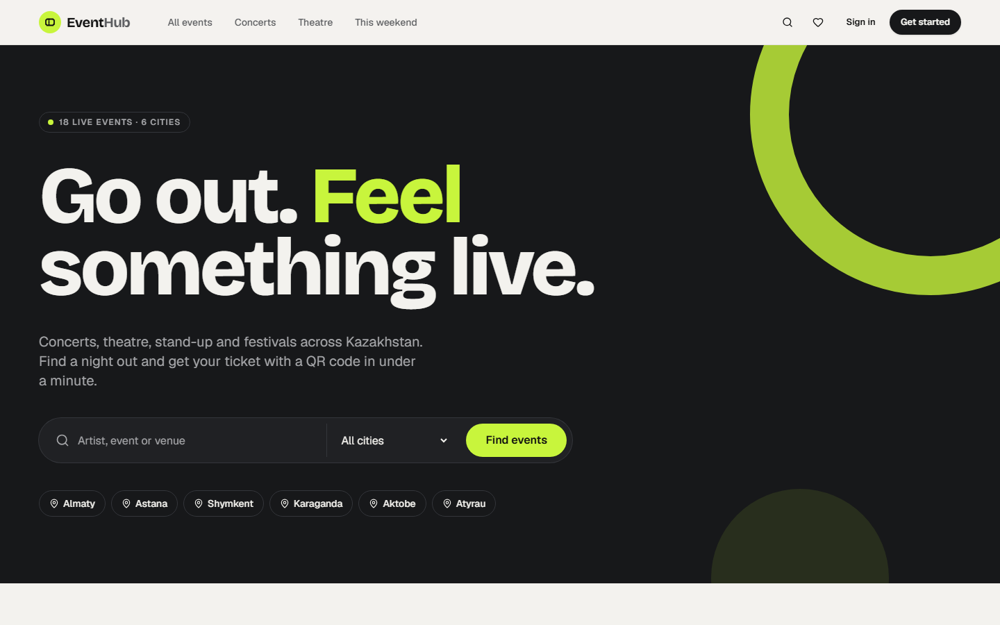

## Screenshots

All screenshots are taken from the running app with the seeded demo data (`scripts/screenshots.ts`, see [Scripts](#scripts)).

### For visitors

**Catalog with filters.** City, category, date, price and sort live in the URL, so a filtered list can be shared as a link. Every card shows the date, venue and the lowest price in tenge.

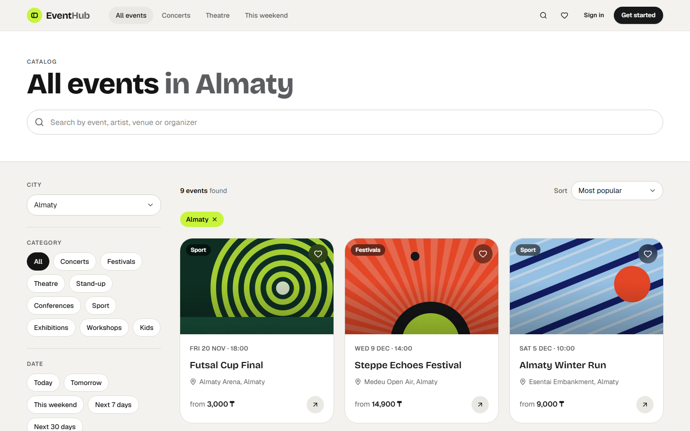

**Event page.** Full-width cover, category and city, a "Save" button for favorites and the starting price. Below the cover are the key facts (date, time, venue), the description, the programme, the venue with a map link and the organizer.

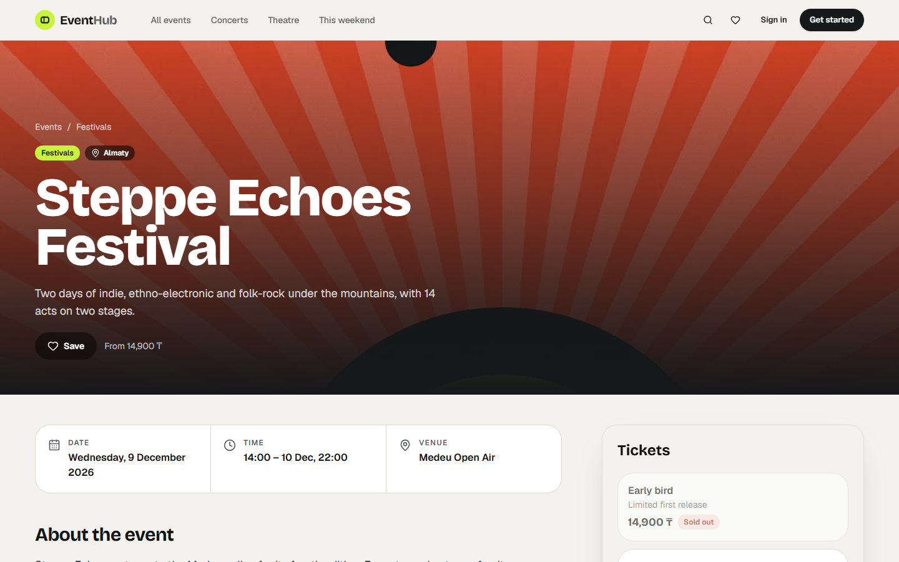

**Choosing tickets.** The ticket panel stays in view while the page scrolls. Each ticket type has its own price, availability and per-order limit; sold-out tiers are greyed out. The total updates as quantities change.

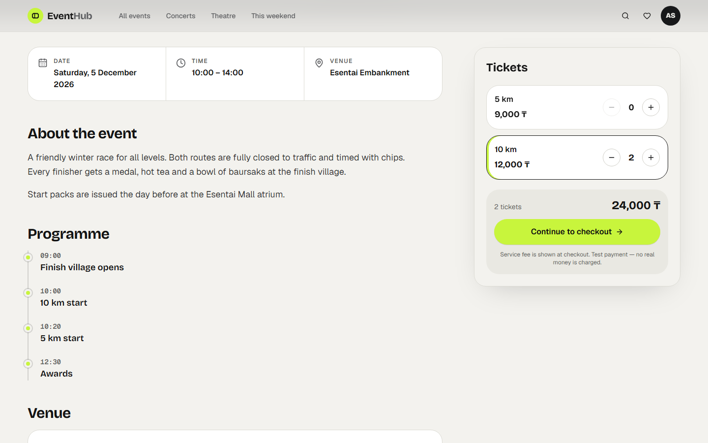

**Checkout.** Quantities can still be changed here. Buyer details are pre-filled from the account, and the order summary shows the subtotal, the 4% service fee and the total. Payment is simulated with test cards (`4242 4242 4242 4242` succeeds, `4000 0000 0000 0002` is declined); prices and availability are checked again on the server.

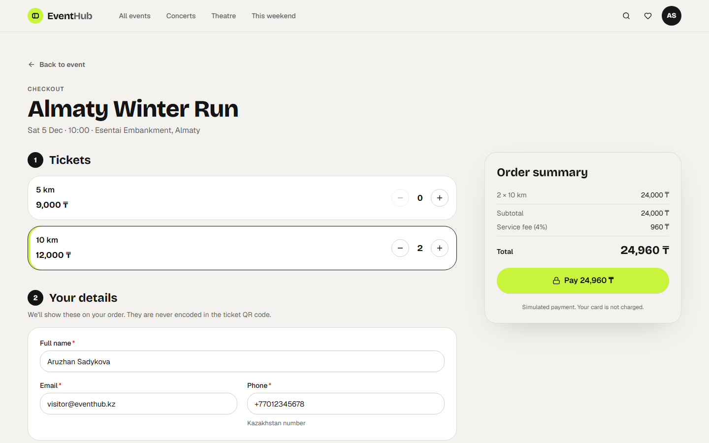

**Confirmation and QR tickets.** Each ticket has its own QR code. The QR contains only a random code — no name, email or phone. Tickets can be printed and are always available in the account.

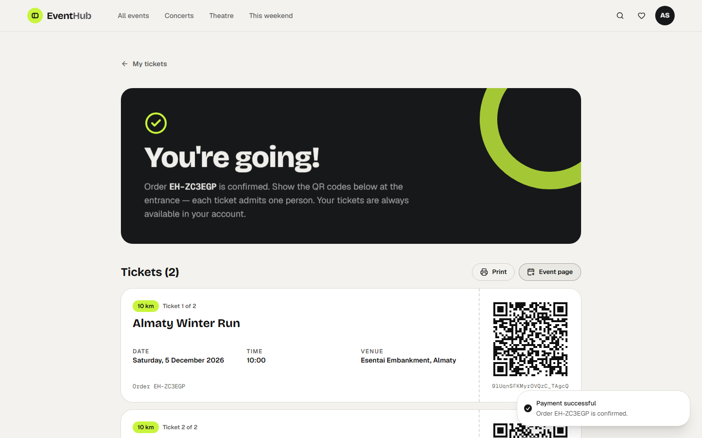

**My tickets.** Upcoming and past bookings, with ticket count, order number, total and check-in status. The account also has Favorites and Settings tabs.

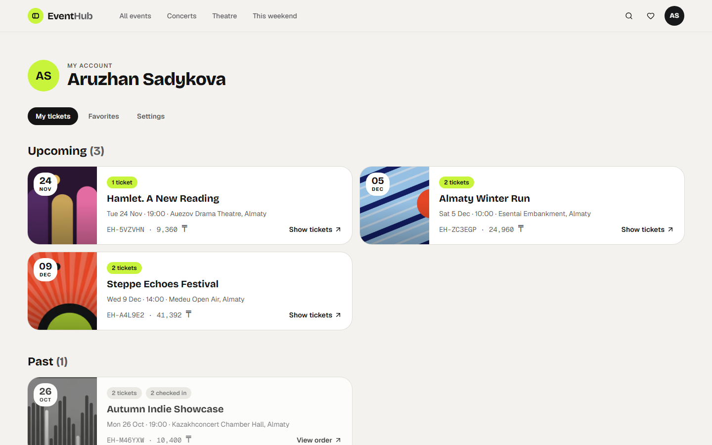

### For organizers

**Overview.** Orders, tickets sold, test sales and check-ins, a 14-day sales chart (Kazakhstan time) and how full each upcoming event is.

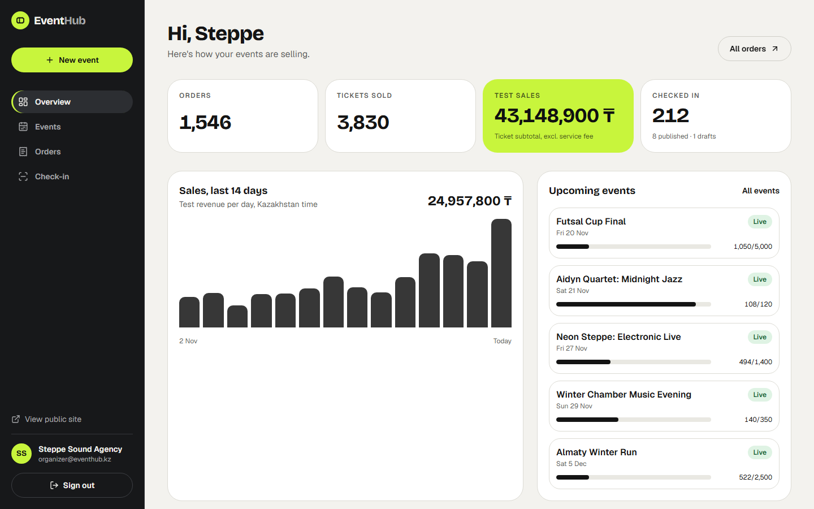

**My events.** Status (draft / published / ended), sales and check-ins per event. The Live switch publishes or unpublishes instantly (optimistic update), and deleting asks for confirmation.

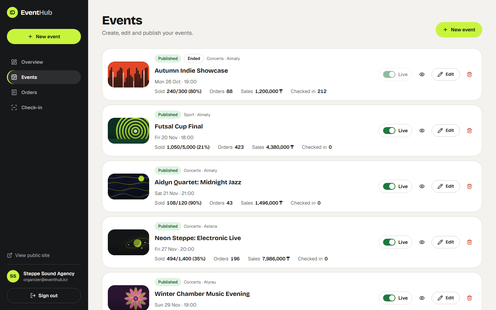

**Event editor.** One form for creating and editing: basics, cover upload, date and venue, ticket types and programme. For each ticket type the form shows how many are sold, and quantity can't be set below that.

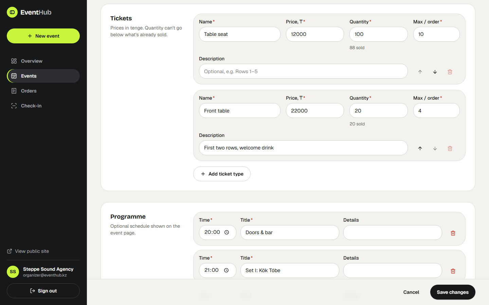

**Orders.** Every order for the organizer's events, with search, event and attendance filters (also stored in the URL) and check-in progress.

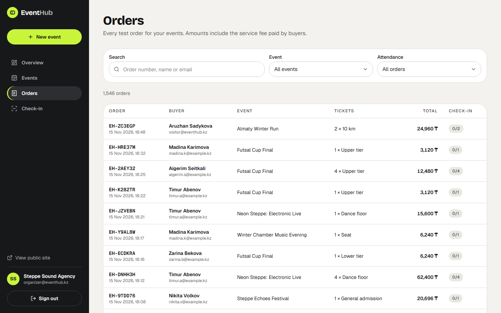

**Check-in at the door.** Scan the QR with a phone camera or type the code. The ticket is checked on the server (only the organizer's own events are accepted) and "Mark as attended" works once — scanning again shows "Already checked in".

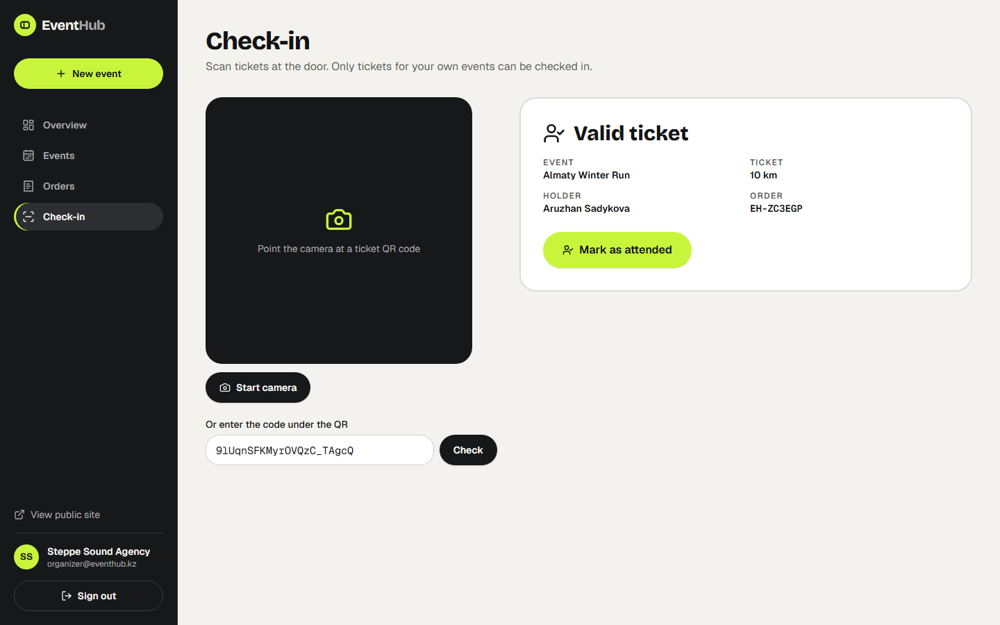

### Mobile

The layout is built for phones too: on small screens filters open in a sheet and the ticket panel follows the event details.

|                       Home                       |                        Catalog                         |                             Tickets                             |
| :----------------------------------------------: | :----------------------------------------------------: | :-------------------------------------------------------------: |
| 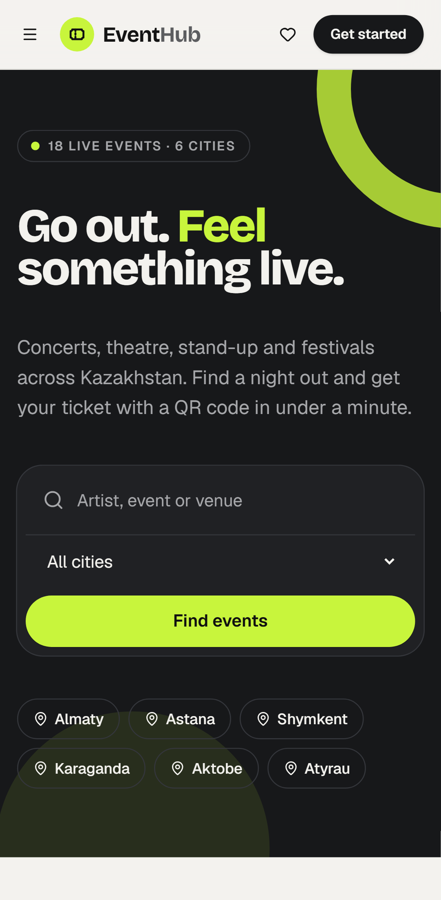 | 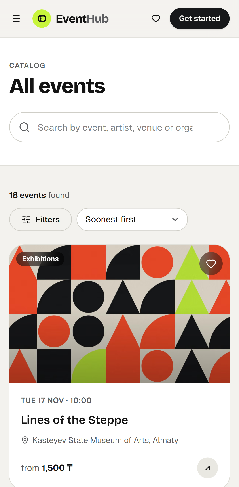 | 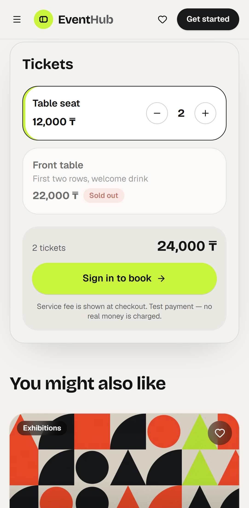 |

## Stack

| Area         | Choice                                                                                                 |
| ------------ | ------------------------------------------------------------------------------------------------------ |
| Framework    | Next.js 16 (App Router, React 19, Server Components), TypeScript `strict` + `noUncheckedIndexedAccess` |
| UI           | Tailwind CSS 4, shadcn/ui-style components on Radix primitives, lucide icons, sonner toasts            |
| Data         | PostgreSQL + Prisma 7 (`prisma-client` generator, `@prisma/adapter-pg`)                                |
| Auth         | Better Auth (email + password, DB sessions in httpOnly cookies), roles `VISITOR` / `ORGANIZER`         |
| Client data  | TanStack Query (dashboard, favorites, optimistic updates)                                              |
| Forms        | React Hook Form + Zod 4 (the same schemas validate on the server)                                      |
| Client state | Zustand — only for guest favorites (persisted in localStorage)                                         |
| Tests        | Vitest + React Testing Library, Playwright, GitHub Actions                                             |

## Quick start

Requirements: Node.js ≥ 20.19 and PostgreSQL ≥ 14 (local install or Docker).

```bash
npm install                 # also generates the Prisma client
cp .env.example .env        # then edit DATABASE_URL and BETTER_AUTH_SECRET

# Option A — PostgreSQL in Docker (matches .env.example, port 5433)
docker compose up -d

# Option B — an existing PostgreSQL: create a database and point DATABASE_URL at it
#   CREATE USER eventhub WITH PASSWORD 'eventhub' CREATEDB;
#   CREATE DATABASE eventhub OWNER eventhub;

npm run setup               # apply migrations + seed demo data
npm run dev                 # http://localhost:3000
```

`npm run db:seed` can be re-run at any time to reset demo data (event dates are relative to "now", so the catalog never goes stale).

## Environment variables

| Variable                | Required | Description                                                                      |
| ----------------------- | -------- | -------------------------------------------------------------------------------- |
| `DATABASE_URL`          | yes      | PostgreSQL connection string                                                     |
| `BETTER_AUTH_SECRET`    | yes      | ≥ 32 random chars, e.g. `openssl rand -base64 32`                                |
| `BETTER_AUTH_URL`       | yes      | Public origin of the app (auth callbacks)                                        |
| `NEXT_PUBLIC_APP_URL`   | yes      | Same origin; used for metadata, sitemap and QR check-in links                    |
| `NEXT_PUBLIC_DEMO_MODE` | no       | `"true"` shows one-click demo sign-in buttons. Use `"false"` in real deployments |
| `DEMO_PASSWORD`         | no       | Password the seed script gives demo accounts (default `eventhub-demo`)           |

Server env is validated with Zod at startup (`src/server/env.ts`) and fails fast with a readable message. No secrets are committed — `.env` is git-ignored, `.env.example` documents everything.

## Demo accounts and scenarios

The sign-in page has **Try a demo account** buttons (when `NEXT_PUBLIC_DEMO_MODE=true`). All demo accounts use the password from `DEMO_PASSWORD`.

| Account                 | Role      | What's there                                                                   |
| ----------------------- | --------- | ------------------------------------------------------------------------------ |
| `visitor@eventhub.kz`   | Visitor   | 2 upcoming bookings, 1 past (checked in), 3 favorites                          |
| `organizer@eventhub.kz` | Organizer | Steppe Sound Agency: 9 events incl. a draft and a past one, hundreds of orders |
| `stage@eventhub.kz`     | Organizer | Second organizer — use it to verify you can't touch Steppe's events            |
| `nomad@eventhub.kz`     | Organizer | Third organizer (tech events)                                                  |

Seed data: 21 events (18 upcoming published, 2 past, 1 draft) across 9 categories and 7 cities; ~2,600 orders and ~6,300 tickets. Every sold ticket is a real `Order` + `Ticket` row, so the dashboard numbers are consistent with inventory — nothing is faked. Covers are generated posters (`npm run covers`, see `scripts/generate-covers.ts`) — no stock photos, no licensing questions, works offline.

**Try these flows**

1. _Visitor booking:_ Catalog → search "Winter Run" → event page → pick 2 × "10 km" → Continue → buyer details are pre-filled → **Fill in the test card** → Pay → success page with 2 QR tickets → **My tickets**.
2. _Declined payment:_ use card `4000 0000 0000 0002` at checkout; nothing is charged and no inventory is reserved.
3. _Sold out / few left:_ "Aidyn Quartet: Midnight Jazz" has a sold-out tier and one with few seats left.
4. _Guest favorites:_ signed out, tap hearts → `/favorites` → sign in → they are moved into the account.
5. _Organizer:_ sign in as organizer → Overview (orders, tickets, test sales, 14-day chart) → Events → **New event** (upload a cover, add ticket types and a programme) → Create draft → Publish → it appears in the catalog.
6. _Check-in:_ open an order as the visitor, copy the code under a QR (or scan it with the dashboard camera on a phone) → organizer **Check-in** → Mark as attended → scanning again shows "Already checked in".
7. _Access control:_ sign in as `stage@eventhub.kz` and open `/organizer/events/<steppe-event-id>/edit` → 404; the API returns 404 too.

## Project structure

```
prisma/
  schema.prisma          data model (auth tables follow Better Auth's schema)
  migrations/            SQL migrations incl. CHECK constraints for inventory
  seed.ts, seed-data.ts  demo data
scripts/generate-covers.ts
src/
  app/
    (public)/            site with header/footer: home, events, event page, checkout,
                         orders, favorites, sign-in/up, account/*
    organizer/           organizer dashboard (own layout with graphite sidebar)
    api/                 route handlers (JSON, consistent error shape)
    sitemap.ts, robots.ts, error.tsx, not-found.tsx
  components/
    ui/                  design-system primitives (button, field, dialogs, badge…)
    catalog/ booking/ events/ tickets/ account/ organizer/ auth/ favorites/ layout/
  hooks/use-favorites.ts unified favorites (server + optimistic, or local for guests)
  stores/                Zustand store (guest favorites)
  lib/                   pure, framework-free logic: pricing, dates, formatting, Zod schemas
  server/                server-only code: env, db, auth, session, http helpers, services/*
tests/unit               Vitest + RTL (logic + components)
tests/integration        Vitest against a real PostgreSQL (orders, ownership)
e2e/                     Playwright scenarios
```

## Architecture decisions

**Server Components by default, client components at the edges.** Public pages (home, catalog, event page, tickets) are rendered on the server straight from Prisma — fast first paint, good SEO, no client fetching waterfalls. Interactivity lives in small client islands (filters, ticket selector, checkout form, dashboard widgets).

**The URL is the state of the catalog.** Search, city, category, date preset/range, price range, sort and page are parsed from `searchParams` with a forgiving Zod schema (`lib/validation/catalog.ts`): bad values fall back to defaults instead of erroring, and serialization is canonical, so links are shareable and the Back button works. The organizer orders table does the same.

**Services own the rules; route handlers are thin.** Every mutation goes through `src/server/services/*`, which validate input with the same Zod schemas the forms use, and enforce authorization. `withAuth()` resolves the session, checks the role and maps `HttpError` / `ZodError` to one JSON error shape (`{ error: { code, message, fields } }`) — forms map `fields` back onto inputs.

**No overselling, no duplicate orders.** `createOrder` runs in a transaction:

1. prices and availability are re-read from the DB (client totals are display-only);
2. the order row is inserted first with a **unique idempotency key** generated once per checkout page — a double click or retry hits the unique constraint and returns the existing order;
3. inventory is reserved with a conditional `UPDATE … SET sold = sold + n WHERE sold + n <= quantity` — if it affects 0 rows, the transaction aborts. A `CHECK (sold <= quantity)` constraint backs it up.
4. The simulated charge runs inside the transaction, so a declined card rolls everything back.

The UI also disables the Pay button while a request is in flight.

**Ownership is checked on the server, always.** All organizer queries are scoped by `organizerId`; someone else's event/ticket returns **404** (not 403) so ids can't be probed. Covers can only be attached by the organizer who uploaded them. Customers' order pages are scoped by `userId`. The role is chosen at sign-up and Better Auth hooks strip it from any later update (no self-promotion).

**QR codes contain no personal data.** Each ticket gets a random 128-bit code; the QR encodes only `…/organizer/check-in?code=…`. Check-in flips `VALID → USED` atomically, so two scanners can't admit the same ticket twice.

**Uploads.** Cover files are size-limited (4 MB) before and after upload, and the real type is detected from magic bytes (JPEG/PNG/WebP), not from the filename or browser MIME. Files are stored in PostgreSQL (`Upload` table) and served with immutable caching and `nosniff`.

**TanStack Query where data changes after load.** The dashboard hydrates from server-rendered `initialData`, refreshes sales every 30 s, and uses **optimistic updates with rollback** for publish/unpublish, deleting events and favorites. Public pages don't need it.

**Zustand only for guest favorites** — the one truly global client state (shared by every heart button, persisted, merged into the account after sign-in). Everything else is server state or local component state.

**Time zone.** Kazakhstan uses a single UTC+5 zone; all dates are stored in UTC and formatted/entered in `Asia/Almaty` (`lib/dates.ts`, `lib/format.ts`), including the "this weekend" filter and daily sales buckets.

**Design.** Warm light surfaces, graphite blocks and one lime accent, with Bricolage Grotesque for display type and Geist for UI. A `.surface-dark` class re-maps the same tokens so components work on graphite without variants. Cards differ by context: poster cards for featured events, a timetable list for "coming up", classic cards in the catalog, ticket stubs for orders. Motion is limited to short rise/hover transitions and respects `prefers-reduced-motion`.

**Accessibility.** Skip link, visible `:focus-visible` rings everywhere (including stretched-link cards), labelled controls via a `Field` component that wires `aria-invalid` / `aria-describedby`, `role="alert"` errors, live regions for result counts and totals, keyboard-operable steppers, switches and dialogs (Radix), a screen-reader table behind the sales chart.

**SEO.** `generateMetadata` for catalog and event pages (title, description, canonical, Open Graph image = cover), schema.org `Event` JSON-LD with offers in KZT, `sitemap.xml` and `robots.txt` (private areas disallowed).

## Scripts

| Command                           | What it does                                                   |
| --------------------------------- | -------------------------------------------------------------- |
| `npm run dev` / `build` / `start` | Next.js                                                        |
| `npm run typecheck`               | `tsc --noEmit` (strict)                                        |
| `npm run lint`                    | ESLint (Next core-web-vitals + TypeScript)                     |
| `npm run format` / `format:check` | Prettier: format all files / check formatting (runs in CI)     |
| `npm test`                        | Unit and component tests (jsdom)                               |
| `npm run test:integration`        | Order + ownership tests against the database in `DATABASE_URL` |
| `npm run test:e2e`                | Playwright (builds must exist: `npm run build`; seed first)    |
| `npm run setup`                   | `prisma migrate deploy` + seed                                 |
| `npm run db:seed` / `db:reset`    | Reset demo data / reset the whole DB                           |
| `npm run covers`                  | Regenerate demo cover images                                   |
| `npm run screenshots`             | Retake README screenshots (needs `db:seed` + app on port 3100) |

CI (`.github/workflows/ci.yml`): typecheck → lint → format check → unit tests, then with a PostgreSQL service: migrate → seed → integration tests → build → Playwright.

## Tests

- **Pricing & validation** (`tests/unit/pricing.test.ts`, `validation.test.ts`, `dates.test.ts`): totals and service fee rounding, availability/limit rules, URL selection encoding, phone normalization, Luhn/expiry checks, event form rules (end after start, unique ticket names, NaN inputs), catalog param fallback, KZ time conversions and the weekend preset.
- **Components** (`ticket-selector`, `checkout-form`, `components`): quantity bounds and totals, guest redirect to sign-in, accessible validation errors, **one request on double click with an idempotency key**, server error display, guest favorites toggle, keyboard stepper, field ARIA wiring, upload pre-check.
- **Integration** (`tests/integration`): real PostgreSQL — order creation, idempotent double submit, **8 concurrent buyers for 5 seats never oversell**, declined card rollback, drafts not purchasable; **another organizer can't read, edit, unpublish, delete, list orders of, or check in tickets for someone else's event**; sold ticket types can't be removed.
- **E2E** (`e2e/`): search → pick tickets → test payment → tickets in account; guest sign-in round trip back to checkout; shareable filters; cross-organizer access returns 404 in UI and API; visitor blocked from organizer area; mobile sheets, no horizontal overflow, skip link.

### Results (this machine)

| Check                      | Result                                                |
| -------------------------- | ----------------------------------------------------- |
| `npm run typecheck`        | ✅ no errors                                          |
| `npm run lint`             | ✅ no errors or warnings                              |
| `npm test`                 | ✅ 6 files, 64 tests passed                           |
| `npm run build`            | ✅ production build succeeded                         |
| `npm run test:integration` | ✅ 2 files, 11 tests passed (PostgreSQL 17 in Docker) |
| `npm run test:e2e`         | ✅ 8 scenarios passed (desktop Chrome + Pixel 7)      |

Run on Windows 11, Node 24, against `docker compose` PostgreSQL. CI runs the same steps on Ubuntu (it hasn't been pushed to GitHub yet).

> Windows note: if Vitest reports "failed to find the current suite", the terminal's working directory uses a lower-case drive letter (`c:\…`). `cd C:\Users\…\EventHub` (capital `C:`) and run again — this is a Vitest/Windows path-casing quirk, not a test failure.

## Limitations

- Payment is a local simulation (test cards only); no payment provider is called.
- Emails (confirmation, password reset) are not sent; tickets are always available in the account and printable.
- Uploaded covers are stored in PostgreSQL to keep the project self-contained. For production, move them to object storage (S3/R2) and keep only URLs in the DB.
- Seat maps, refunds and promo codes are out of scope. `Order.status` already has `CANCELLED` for a future refund flow.
- Demo sign-in buttons expose the demo password by design; disable them with `NEXT_PUBLIC_DEMO_MODE=false`.
